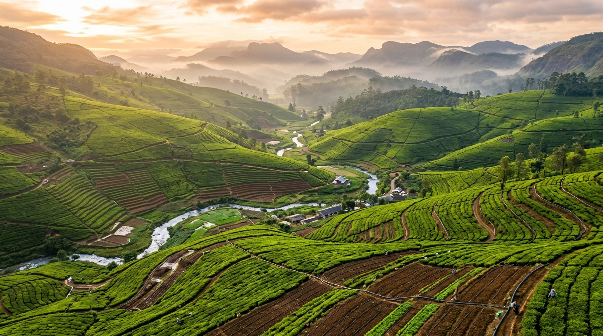

# 🌱 AgroPulse — Smart Agriculture & Farm Operations Platform

<p align="center">
  <strong>A smarter way to manage farms, crops, resources, and agricultural business operations.</strong>
</p>

<p align="center">
  <a href="https://github.com/SilvaDeShakila/AgroPulse">
    
  </a>
  <a href="https://github.com/SilvaDeShakila/AgroPulse/issues">
    
  </a>
  <a href="https://github.com/SilvaDeShakila/AgroPulse/commits/main">
    
  </a>
  <a href="https://github.com/SilvaDeShakila/AgroPulse">
    
  </a>
</p>

<p align="center">
  
  
  
  
  
  
</p>

---

## 📌 Overview

**AgroPulse** is a full-stack smart agriculture and farm operations management platform designed around the needs of Sri Lankan agriculture.

The platform brings farm management, crop lifecycle tracking, field operations, inventory control, weather intelligence, financial records, and agricultural marketplace workflows into one application.

From managing agricultural land and monitoring crop growth to recording harvests and tracking operational expenses, AgroPulse aims to provide farmers and agricultural teams with a more organized, data-informed approach to daily operations.

### 🎯 Project Goals

- Digitize essential farm management workflows.
- Improve visibility into crop growth and agricultural activities.
- Track inventory, expenses, harvests, and operational performance.
- Support collaboration between farmers, workers, agronomists, buyers, and suppliers.
- Provide weather information and practical agricultural advisories.
- Demonstrate full-stack development, API design, authentication, and access control in a real-world domain.

---

## 🖼️ Application Preview

<p align="center">
  
</p>

<p align="center">
  <em>AgroPulse — technology-driven farm operations for Sri Lanka.</em>
</p>

---

## ✨ Key Features

### 🌾 1. Farm & Land Management
- Organize agricultural farms and estates.
- Manage land plots and plot identifiers.
- Record farm locations, land areas, soil types, and irrigation methods.
- Support acre-to-hectare area conversion.
- Visualize farm and plot information.

### 🌱 2. Crop Lifecycle Management
- Track crop development from land preparation to harvesting.
- Manage crop cycles and Maha/Yala seasonal activities.
- Record crop observations and agronomic issues.
- Compare expected and actual harvest yields.
- Organize crop-related operational information.

### 👨‍🌾 3. Task & Workforce Management
- Create and assign agricultural tasks.
- Organize work by category, priority, and due date.
- Track task progress and completion.
- Support field-worker coordination.

### 📦 4. Inventory & Resource Management
- Maintain agricultural input and supply records.
- Track seeds, fertilizers, agrochemicals, tools, and other supplies.
- Record stock receipts and stock issues.
- Support low-stock alerts and inventory movement tracking.
- Apply stock validation to help prevent invalid deductions.

### 🌦️ 5. Weather Intelligence
- Integrate weather information from Open-Meteo.
- Display relevant weather conditions and forecast information.
- Present temperature, humidity, precipitation, and wind data where available.
- Provide rule-based agricultural advisories based on weather conditions.

### 💰 6. Harvest & Financial Management
- Record harvest quantities and quality grades.
- Track production expenses and operating costs.
- Calculate estimated revenue, net margin, and land yield.
- Export supported financial reports as CSV files.

### 🛒 7. Agricultural Marketplace
- Organize produce listings with pricing, quantities, and origin information.
- Support marketplace order workflows.
- Track order fulfilment statuses.
- Include stock validation in order processing.

### 🧠 8. Operational Recommendations
- Highlight operational tasks that may need attention.
- Identify relevant inventory, weather, and harvest considerations.
- Provide actionable links to related application modules.

### 🔐 9. Authentication & Role-Based Access Control
- Support account registration and login workflows.
- Hash passwords using `bcryptjs`.
- Use signed JSON Web Tokens (JWT) for authenticated API requests.
- Apply role-based authorization to protected operations.
- Include request rate limiting for sensitive authentication endpoints.

### 📋 10. Audit & Reporting
- Maintain operational audit records.
- Support filtering and reviewing audit activity.
- Provide CSV export for supported records.

---

## 🧑‍💻 Technology Stack

| Category | Technologies |
|---|---|
| Frontend | React 19, TypeScript |
| Build Tool | Vite |
| Styling | Tailwind CSS v4 |
| Backend | Node.js, Express.js |
| Authentication | bcryptjs, JSON Web Tokens |
| Database | JSON-based local persistence; optional PostgreSQL integration |
| Database Driver | `pg` |
| Weather Data | Open-Meteo API |
| Icons | Lucide React |
| Animation | Motion |
| Testing | TypeScript-based automated tests |
| Version Control | Git & GitHub |

---

## 🏗️ Architecture

AgroPulse uses a full-stack architecture with a React frontend and an Express backend.

```text
AgroPulse
│
├── Frontend
│   ├── React
│   ├── TypeScript
│   ├── Vite
│   └── Feature-based UI components
│
├── Backend
│   ├── Express.js
│   ├── REST API
│   ├── Authentication middleware
│   ├── Role-based access control
│   └── Application services
│
├── Data Layer
│   ├── Local persistent JSON storage
│   ├── Database repositories
│   ├── SQL schema and migrations
│   └── Optional PostgreSQL adapter
│
└── External Integration
    └── Open-Meteo Weather API
```

The backend API uses the `/api/v1` prefix for its documented versioned endpoints.

---

## 🗂️ Project Structure

```text
AgroPulse/
├── laravel/
│   ├── DATABASE_SCHEMA.sql
│   └── MIGRATION_PLAN.md
├── public/
├── src/
│   ├── assets/
│   ├── components/
│   │   ├── audit/
│   │   ├── auth/
│   │   ├── crops/
│   │   ├── dashboard/
│   │   ├── farms/
│   │   ├── finance/
│   │   ├── inventory/
│   │   ├── marketplace/
│   │   ├── recommendations/
│   │   ├── tasks/
│   │   └── weather/
│   ├── data/
│   ├── server/
│   │   ├── db/
│   │   ├── middleware/
│   │   └── services/
│   ├── services/
│   ├── types/
│   └── App.tsx
├── tests/
│   ├── agropulse.test.ts
│   └── postgres.test.ts
├── .env.example
├── .gitignore
├── package.json
├── server.ts
├── tsconfig.json
└── vite.config.ts
```

---

## ⚙️ Getting Started

### Prerequisites

Install the following before running the application:

- [Node.js](https://nodejs.org/) — use a version compatible with the project dependencies.
- npm — included with Node.js.
- Git — for cloning the repository.

### 1. Clone the Repository

```bash
git clone https://github.com/SilvaDeShakila/AgroPulse.git
cd AgroPulse
```

### 2. Install Dependencies

```bash
npm install
```

### 3. Configure Environment Variables

Review the provided `.env.example` file and identify which variables are required by the selected application features.

If your setup requires environment variables, create a local `.env` file and configure the appropriate values.

**Security:** Never commit `.env` files, passwords, API secrets, database credentials, or authentication tokens.

### 4. Start the Development Server

```bash
npm run dev
```

The server is configured to use port `3000` by default. Check the terminal output for the actual local URL and server status.

### 5. Run the TypeScript Check

```bash
npm run lint
```

### 6. Run the Automated Tests

```bash
npm test
```

### 7. Build the Frontend

```bash
npm run build
```

Use the command outputs to confirm whether the checks pass in your environment.

---

## 🔌 API Overview

The backend documents REST endpoints for the following operations:

| Area | Example Endpoint | Purpose |
|---|---|---|
| Health | `GET /api/v1/health` | Check server health |
| Database | `GET /api/v1/db-status` | Inspect database status |
| Authentication | `POST /api/v1/auth/register` | Register an account |
| Authentication | `POST /api/v1/auth/login` | Authenticate a user |
| Farms | `GET /api/v1/farms` | Retrieve authorized farms |
| Crop Cycles | `GET /api/v1/crop-cycles` | Retrieve crop cycles |
| Tasks | `GET /api/v1/tasks` | Retrieve agricultural tasks |
| Inventory | `GET /api/v1/inventory` | Retrieve inventory |
| Harvests | `GET /api/v1/harvests` | Retrieve harvest records |
| Finance | `GET /api/v1/finance/summary` | Retrieve financial summaries |
| Marketplace | `GET /api/v1/marketplace/listings` | Retrieve produce listings |
| Weather | `GET /api/v1/weather` | Retrieve weather information |
| Audit Logs | `GET /api/v1/audit-logs` | Retrieve authorized audit records |

Some endpoints require authentication and specific roles. Refer to the backend implementation for the applicable permissions and request/response formats.

---

## 🗄️ Database Options

AgroPulse includes local persistent JSON storage and a PostgreSQL integration path.

### Local Persistence

The application documents its default local data store under:

```text
.data/agropulse_database.json
```

Keep local application data out of version control.

### PostgreSQL

The repository includes SQL schemas, migrations, and a PostgreSQL adapter. To use PostgreSQL:

1. Configure a valid `DATABASE_URL` in your local environment.
2. Review `src/server/db/schema.sql` and the migration scripts.
3. Apply the required schema and migrations using the documented setup for your database.
4. Start the server and check its database status.

The `laravel/` directory contains separate schema and migration planning documents; it does not, by itself, mean the main application is a Laravel implementation.

---

## 🔒 Security Considerations

- Passwords are designed to be hashed rather than stored as plaintext.
- Protected API routes use authentication and role-based authorization.
- Sensitive authentication endpoints include rate-limiting logic.
- Local environment files and runtime data are excluded from Git tracking.
- Administrative access should be provisioned through the intended secure workflow.
- Database credentials and signing secrets must be kept out of source control.

Before deploying publicly, review authentication flows, authorization rules, database permissions, error handling, environment configuration, and production server settings.

---

## 🧪 Testing & Quality

The repository includes test files for application behavior and PostgreSQL-related functionality.

Run the available checks:

```bash
npm run lint
npm test
npm run build
```

Review the output of each command before treating the application as production-ready. PostgreSQL-specific tests may require a correctly configured database environment.

---

## 🛣️ Roadmap

Potential future improvements include:

- [ ] Continuous Integration (CI) with automated build and test checks.
- [ ] Production deployment and environment documentation.
- [ ] Expanded integration and end-to-end testing.
- [ ] More detailed monitoring and operational observability.
- [ ] Additional agricultural analytics and reporting.
- [ ] Improved documentation for API requests and responses.
- [ ] Further security and accessibility reviews.

---

## 🤝 Contributing

Contributions, suggestions, and bug reports are welcome.

1. Fork the repository.
2. Create a feature branch.
3. Make your changes.
4. Run the relevant checks.
5. Open a pull request with a clear description of the changes.

For bugs or feature suggestions, use the [GitHub Issues](https://github.com/SilvaDeShakila/AgroPulse/issues) page.

---

## 📄 License

No license has been specified in this README. Until a license is added to the repository, do not assume that the project is available for unrestricted reuse or redistribution.

---

## 👨‍💻 Author

**Shakila De Silva**

- GitHub: [@SilvaDeShakila](https://github.com/SilvaDeShakila)
- Project: [AgroPulse — Smart Agriculture & Farm Operations Platform](https://github.com/SilvaDeShakila/AgroPulse)

---

<p align="center">
  <strong>🌱 Building smarter agricultural workflows with technology.</strong>
</p>

<p align="center">
  If you find this project interesting, consider giving the repository a ⭐ on GitHub.
</p>
